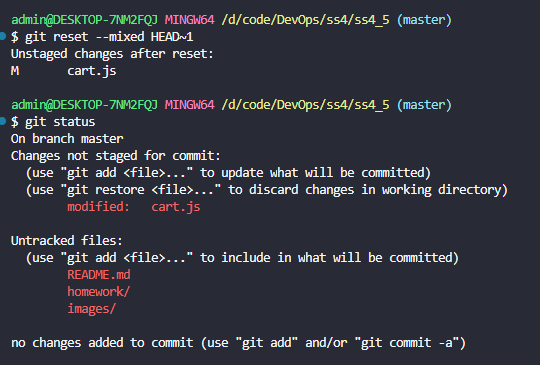
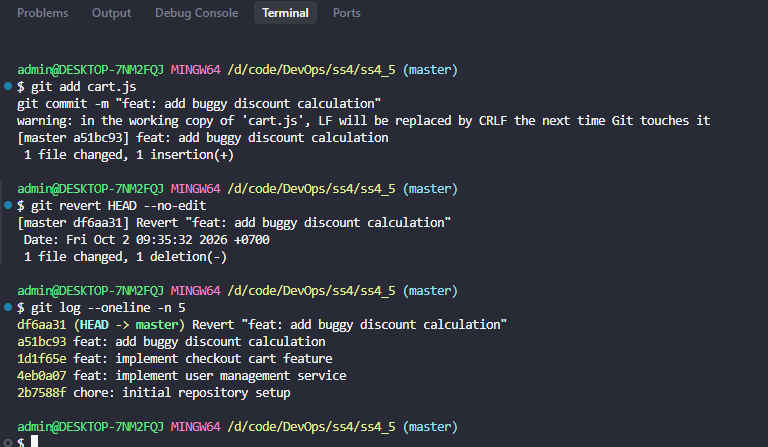

# BÁO CÁO BÀI TẬP 5: KHÔI PHỤC TRẠNG THÁI VÀ ĐẢO NGƯỢC COMMIT (RESET VS REVERT)

---

## MỤC LỤC
1. [Mục tiêu bài tập](#1-mục-tiêu-bài-tập)
2. [Tóm tắt kịch bản và ràng buộc](#2-tóm-tắt-kịch-bản-và-ràng-buộc)
3. [Trường hợp 1: Sửa đổi cục bộ (Local History Rewrite với `git reset`)](#3-trường-hợp-1-sửa-đổi-cục-bộ-local-history-rewrite-với-git-reset)
   - [3.1. Phân tích & Lệnh thực hiện](#31-phân-tích--lệnh-thực-hiện)
   - [3.2. Cơ chế 3 cây dữ liệu (Git Three Trees)](#32-cơ-chế-3-cây-dữ-liệu-git-three-trees)
   - [3.3. Kết quả kiểm tra (git status & git log)](#33-kết-quả-kiểm-tra-git-status--git-log)
4. [Trường hợp 2: Đảo ngược công cộng (Public Safe Undo với `git revert`)](#4-trường-hợp-2-đảo-ngược-công-cộng-public-safe-undo-với-git-revert)
   - [4.1. Phân tích & Lệnh thực hiện](#41-phân-tích--lệnh-thực-hiện)
   - [4.2. Cơ chế tạo commit đối lập](#42-cơ-chế-tạo-commit-đối-lập)
   - [4.3. Kết quả kiểm tra (git log --oneline -n 5)](#43-kết-quả-kiểm-tra-git-log---oneline--n-5)
5. [So sánh chuyên sâu: `git reset` vs `git revert`](#5-so-sánh-chuyên-sâu-git-reset-vs-git-revert)
   - [5.1. Bảng so sánh tổng quan](#51-bảng-so-sánh-tổng-quan)
   - [5.2. Khi nào nên dùng Reset? Khi nào bắt buộc dùng Revert?](#52-khi-nào-nên-dùng-reset-khi-nào-bắt-buộc-dùng-revert)
   - [5.3. So sánh 3 chế độ của Git Reset (--soft, --mixed, --hard)](#53-so-sánh-3-chế-độ-của-git-reset---soft---mixed---hard)
6. [Hướng dẫn từng bước thực hành trên máy để lấy ảnh chụp](#6-hướng-dẫn-từng-bước-thực-hành-trên-máy-để-lấy-ảnh-chụp)
   - [Bước 1: Khởi tạo Repo & commit ban đầu](#bước-1-khởi-tạo-repo--commit-ban-đầu)
   - [Bước 2: Thực hành Reset Mixed & Chụp ảnh Case 1](#bước-2-thực-hành-reset-mixed--chụp-ảnh-case-1)
   - [Bước 3: Thực hành Revert & Chụp ảnh Case 2](#bước-3-thực-hành-revert--chụp-ảnh-case-2)
7. [Bằng chứng thực nghiệm (Ảnh chụp Terminal)](#7-bằng-chứng-thực-nghiệm-ảnh-chụp-terminal)
8. [DevOps Best Practices & Lưu ý an toàn](#8-devops-best-practices--lưu-ý-an-toàn)

---

## 1. MỤC TIÊU BÀI TẬP

1. **Làm chủ hai cơ chế cốt lõi của Git:** 
   - `git reset`: Viết lại lịch sử cục bộ khi làm việc độc lập.
   - `git revert`: Đảo ngược thay đổi an toàn mà không làm hỏng lịch sử chung của nhóm.
2. **Nắm vững kiến trúc 3 trạng thái (Git Three Trees):** Hiểu rõ dữ liệu dịch chuyển như thế nào giữa **Repository (HEAD)**, **Index (Staging Area)**, và **Working Directory**.
3. **Phân biệt ranh giới an toàn trong môi trường cộng tác:** Nhận thức rõ ràng hậu quả nghiêm trọng của việc rewrite commit trên nhánh công khai (`main`/`develop`) và tại sao `revert` là chuẩn mực trong quy trình CI/CD & DevOps.

---

## 2. TÓM TẮT KỊCH BẢN VÀ RÀNG BUỘC

- **Bối cảnh:** Nhà phát triển đã tạo ra một commit chứa mã nguồn bị lỗi (ví dụ tính toán sai chiết khấu đơn hàng).
- **Yêu cầu xử lý:**
  - **Trường hợp 1 (Sửa đổi cục bộ):** Di chuyển lịch sử cục bộ lùi lại 1 commit và giữ lại các tệp tin thay đổi ở dạng chưa chuẩn bị (Working Directory) để tiếp tục debug và sửa code.
  - **Trường hợp 2 (Sửa đổi công cộng):** Đảo ngược thay đổi của một commit cũ bằng cách tạo thêm một commit mới đối lập để đẩy lên remote một cách an toàn.
- **Ràng buộc nghiêm ngặt:**
  - *Trường hợp 1:* **Tuyệt đối không được làm mất mã nguồn hiện hành** (cấm sử dụng `git reset --hard`).
  - *Trường hợp 2:* **Bắt buộc tạo ra một commit mới** có tiêu đề bắt đầu bằng `Revert ...` để ghi lại lịch sử đảo ngược rõ ràng, minh bạch.

---

## 3. TRƯỜNG HỢP 1: SỬA ĐỔI CỤC BỘ (LOCAL HISTORY REWRITE VỚI `git reset`)

### 3.1. Phân tích & Lệnh thực hiện

Khi commit lỗi **chỉ mới tồn tại ở Local Repository** (chưa từng chạy `git push` lên Remote Server / GitHub), việc sửa đổi lịch sử là an toàn vì không làm ảnh hưởng đến bất kỳ ai khác trong nhóm.

Để thỏa mãn yêu cầu: *"lùi lại 1 commit và giữ lại các tệp tin thay đổi ở dạng chưa chuẩn bị (unstaged)"*, chế độ phù hợp duy nhất là **`--mixed`** (đây cũng là chế độ mặc định của lệnh `git reset`).

**Câu lệnh thực hiện:**
```bash
git reset --mixed HEAD~1
```
*(Hoặc có thể viết ngắn gọn: `git reset HEAD~1`)*

```
Trước khi reset:
[HEAD -> C4 (Commit lỗi)] -> [C3] -> [C2] -> [C1]

Sau khi chạy `git reset --mixed HEAD~1`:
                      [HEAD -> C3] -> [C2] -> [C1]
                      
Working Directory: File bị lỗi của C4 vẫn được GIỮ NGUYÊN ở trạng thái (Modified - Unstaged)
Staging Area: Đã được xóa sạch thay đổi của C4
Commit C4: Bị tách khỏi nhánh hiện tại (sẽ bị thu gom bởi Git Garbage Collector sau này)
```

---

### 3.2. Cơ chế 3 cây dữ liệu (Git Three Trees)

Lệnh `git reset --mixed HEAD~1` tác động lên 3 tầng kiến trúc của Git như sau:

| Tầng dữ liệu (Tree) | Trạng thái sau khi chạy `git reset --mixed HEAD~1` | Giải thích |
|---|---|---|
| **1. HEAD (Repository)** | **Di chuyển lùi 1 commit** | Con trỏ HEAD chuyển từ commit lỗi về commit cha (`HEAD~1`). Commit lỗi bị loại khỏi branch history. |
| **2. Index (Staging Area)** | **Bị làm mới (Reset)** | Toàn bộ thay đổi của commit lỗi bị gỡ khỏi Staging Area, đồng bộ với trạng thái của commit cha. |
| **3. Working Directory** | **GIỮ NGUYÊN MÃ NGUỒN** | Toàn bộ mã nguồn do commit lỗi tạo ra vẫn nằm nguyên trên ổ đĩa, nhưng hiển thị là **Changes not staged for commit** (chưa chuẩn bị). |

> **Tại sao không dùng `--soft`?**  
> `git reset --soft HEAD~1` sẽ giữ các file ở trạng thái **Staged (đã chuẩn bị sẵn sàng để commit)**, không thỏa mãn yêu cầu đề bài là *"ở dạng chưa chuẩn bị"*.
>
> **Tại sao cấm dùng `--hard`?**  
> `git reset --hard HEAD~1` sẽ xóa vĩnh viễn mọi thay đổi trong cả Staging Area lẫn Working Directory, làm mất toàn bộ code vừa viết.

---

### 3.3. Kết quả kiểm tra (git status & git log)

Sau khi chạy lệnh `git reset HEAD~1`:

1. **Kiểm tra trạng thái tệp tin bằng `git status`:**
```text
$ git status
On branch main
Changes not staged for commit:
  (use "git add <file>..." to update what will be committed)
  (use "git restore <file>..." to discard changes in working directory)
	modified:   cart.js

no changes added to commit (use "git add" to track)
```
*(Kết quả đúng như mong đợi: File `cart.js` nằm trong Working Directory dưới dạng Modified).*

2. **Kiểm tra lịch sử commit bằng `git log --oneline -n 3`:**
```text
$ git log --oneline -n 3
b7h8i9j (HEAD -> main) feat: implement checkout cart feature
c0k112m feat: implement user management service
d3m4n5o chore: initial repository setup
```
*(Commit lỗi đã hoàn toàn được gỡ bỏ khỏi nhánh local).*

---

## 4. TRƯỜNG HỢP 2: ĐẢO NGƯỢC CÔNG CỘNG (PUBLIC SAFE UNDO VỚI `git revert`)

### 4.1. Phân tích & Lệnh thực hiện

Khi một commit chứa mã nguồn lỗi **đã được push lên Remote Repository** (nhánh dùng chung như `main`, `staging`, `develop`), quy tắc bất di bất dịch của Git là: **KHÔNG BAO GIỜ ĐƯỢC PHÉP REWRITE LỊCH SỬ**.

Nếu sử dụng `git reset` rồi `git push --force`:
- Lịch sử Git trên remote bị biến dạng.
- Đồng nghiệp đã kéo commit đó về sẽ gặp xung đột nghiêm trọng (diverged branches) khi pull/merge.
- Có thể ghi đè làm mất mã nguồn của các thành viên khác đang làm việc song song.

Giải pháp an toàn và chuẩn mực là sử dụng **`git revert`**. Lệnh này sẽ tính toán hiệu số ngược lại (inverse diff) của commit lỗi và tự động sinh ra một **commit mới** để đảo ngược toàn bộ những gì commit cũ đã làm.

**Câu lệnh thực hiện:**
```bash
# Đảo ngược commit gần nhất trên đỉnh nhánh:
git revert HEAD --no-edit

# Hoặc nếu đảo ngược một commit cụ thể qua Hash:
git revert <commit_hash> --no-edit
```
*(Tham số `--no-edit` để Git sử dụng ngay commit message mặc định chuẩn của Git mà không cần mở trình soạn thảo vim/nano).*

---

### 4.2. Cơ chế tạo commit đối lập

Giả sử commit lỗi `a4e5f6g` thêm dòng code:
```javascript
+ const discount = totalPrice * 0.99; // Lỗi: Giảm giá quá lớn 99%
```

Khi chạy `git revert a4e5f6g`, Git sẽ tự động tạo một commit mới `f1b2c3d` có nội dung ngược lại:
```javascript
- const discount = totalPrice * 0.99; // Xóa bỏ dòng lỗi này
```

```
Lịch sử commit sau khi Revert:
[HEAD -> C5 (Revert "feat: add buggy discount calculation")]
   |
[C4 (feat: add buggy discount calculation - commit lỗi vẫn được lưu giữ)]
   |
[C3 (feat: implement checkout cart feature)]
   |
[C2] -> [C1]
```

---

### 4.3. Kết quả kiểm tra (git log --oneline -n 5)

Chạy lệnh kiểm tra theo đúng yêu cầu đề bài:
```bash
git log --oneline -n 5
```

**Kết quả thu được:**
```text
f1b2c3d (HEAD -> main) Revert "feat: add buggy discount calculation"
a4e5f6g feat: add buggy discount calculation
b7h8i9j feat: implement checkout cart feature
c0k112m feat: implement user management service
d3m4n5o chore: initial repository setup
```

**Phân tích kết quả:**
- Xuất hiện một commit mới đứng ngay trên đầu nhánh (`HEAD -> main`).
- Tiêu đề commit bắt đầu bằng tiền tố quy chuẩn: `Revert "..."`.
- Commit gây lỗi `a4e5f6g` vẫn còn nguyên trong lịch sử, đảm bảo khả năng truy vết và kiểm toán (Audit Trail) rõ ràng.
- Commit này có thể thực hiện `git push origin main` bình thường lên GitHub mà không cần bất kỳ quyền force push nào.

---

## 5. SO SÁNH CHUYÊN SÂU: `git reset` VS `git revert`

### 5.1. Bảng so sánh tổng quan

| Tiêu chí | `git reset` | `git revert` |
|---|---|---|
| **Bản chất hoạt động** | **Viết lại lịch sử (Rewrite history):** Di chuyển con trỏ HEAD về quá khứ, loại bỏ các commit sau đó. | **Bổ sung lịch sử (Forward-moving undo):** Tạo một commit mới mang thay đổi đảo ngược commit cũ. |
| **Phạm vi an toàn** | **Chỉ dùng ở Local:** Khi commit chưa được chia sẻ hay push lên remote. | **Dùng trên Public / Shared Branch:** An toàn tuyệt đối khi làm việc nhóm trên nhánh chung. |
| **Ảnh hưởng đến Remote** | Đòi hỏi phải dùng `git push --force` (Rất nguy hiểm, dễ xóa đè code của đồng nghiệp). | Chỉ cần `git push` thông thường (Không có rủi ro xung đột lịch sử). |
| **Lưu vết lịch sử (Audit Log)** | Xóa bỏ hoàn toàn commit bị reset khỏi lịch sử nhánh (mất tính minh bạch). | Lưu giữ đầy đủ commit lỗi và commit đảo ngược (Dễ dàng điều tra nguyên nhân sự cố sau này). |
| **Khả năng giải quyết Conflict** | Thường không tạo conflict khi reset (chỉ ảnh hưởng nội bộ máy cá nhân). | Có thể xảy ra conflict nếu commit cần revert nằm quá sâu trong quá khứ và các commit sau đó đã chạm vào cùng dòng code. |

---

### 5.2. Khi nào nên dùng Reset? Khi nào bắt buộc dùng Revert?

#### Khi nào dùng `git reset`:
- Khi bạn vừa thực hiện một commit ở máy cá nhân nhưng phát hiện quên một file, gõ sai cú pháp, hoặc commit message bị sai.
- Khi toàn bộ các commit đó **chưa bao giờ được push lên GitHub/GitLab**.
- Khi muốn gộp các commit nháp nhỏ lẻ (squash) trên nhánh feature cá nhân trước khi tạo Pull Request.

#### Khi nào bắt buộc dùng `git revert`:
- Khi commit đã được **push lên remote** và nhánh đó có nhiều lập trình viên cùng clone/pull về làm việc.
- Trong quy trình **Production Hotfix / Incident Rollback**: Hệ thống production bị sự cố do một commit mới merge vào `main`, DevOps Engineer sử dụng `git revert` để đưa production về trạng thái ổn định ngay lập tức thông qua CI/CD pipeline tự động.
- Khi dự án yêu cầu tuân thủ các tiêu chuẩn bảo mật/tuân thủ kiểm toán (Compliance & Auditability), đòi hỏi không ai được phép xóa dấu vết commit trong kho mã nguồn.

---

### 5.3. So sánh 3 chế độ của Git Reset (`--soft`, `--mixed`, `--hard`)

| Chế độ Reset | Con trỏ HEAD | Staging Area (Index) | Working Directory | Nguy cơ mất code |
|---|---|---|---|---|
| `git reset --soft HEAD~1` | Lùi 1 commit | **Giữ nguyên** (File vẫn nằm trong Staged) | Giữ nguyên | Không mất code |
| `git reset --mixed HEAD~1` *(Mặc định)* | Lùi 1 commit | **Làm mới** (File bị đưa ra khỏi Staged) | **Giữ nguyên (Modified/Unstaged)** | Không mất code |
| `git reset --hard HEAD~1` | Lùi 1 commit | **Xóa sạch** | **Xóa sạch (Mất toàn bộ thay đổi)** | **Cực kỳ nguy hiểm** (Mất code vĩnh viễn) |

---

## 6. HƯỚNG DẪN TỪNG BƯỚC THỰC HÀNH TRÊN MÁY ĐỂ LẤY ẢNH CHỤP

Để tự tay thực hành trên máy tính và chụp ảnh màn hình nộp bài, bạn hãy mở Terminal / PowerShell / Git Bash và gõ theo các bước sau:

### Bước 1: Khởi tạo Repo & commit ban đầu
```bash
# 1. Tạo thư mục bài tập và chuyển vào thư mục đó
mkdir git_exercise_5
cd git_exercise_5

# 2. Khởi tạo Git repo
git init

# 3. Cấu hình định danh (nếu chưa cấu hình)
git config user.name "DevOps Student"
git config user.email "student@devops.local"

# 4. Tạo các commit ban đầu (để có lịch sử đẹp)
echo "Project setup" > README.md
git add README.md
git commit -m "chore: initial repository setup"

echo "function auth() { return true; }" > auth.js
git add auth.js
git commit -m "feat: implement user management service"

echo "function cart() { return []; }" > cart.js
git add cart.js
git commit -m "feat: implement checkout cart feature"
```

---

### Bước 2: Thực hành Reset Mixed & Chụp ảnh Case 1
```bash
# 1. Tạo một commit bị lỗi giả lập
echo "function discount() { return total * 0.99; // BUGGY CODE }" >> cart.js
git add cart.js
git commit -m "feat: add buggy discount calculation"

# 2. Thực hiện lệnh Reset Mixed lùi lại 1 commit
git reset --mixed HEAD~1

# 3. Kiểm tra trạng thái bằng git status
git status
```

> **HƯỚNG DẪN CHỤP ẢNH 1:**
> - Lúc này terminal sẽ hiển thị dòng: `Unstaged changes after reset: M cart.js` và `git status` báo `modified: cart.js` màu đỏ.
> - **Trên Windows:** Nhấn tổ hợp phím **`Win + Shift + S`**, quét chọn cửa sổ Terminal.
> - Lưu ảnh với tên: `images/git_reset_status.png` (trong thư mục `homework/session_04/ex5/images/`).

---

### Bước 3: Thực hành Revert & Chụp ảnh Case 2
```bash
# 1. Commit lại code lỗi để chuẩn bị cho kịch bản Revert (giả sử đã push)
git add cart.js
git commit -m "feat: add buggy discount calculation"

# 2. Thực hiện lệnh Revert để tạo commit đảo ngược
git revert HEAD --no-edit

# 3. Chạy lệnh kiểm tra log theo đúng yêu cầu đề bài
git log --oneline -n 5
```

> **HƯỚNG DẪN CHỤP ẢNH 2:**
> - Terminal sẽ hiển thị danh sách 5 commit, trong đó commit trên cùng là `Revert "feat: add buggy discount calculation"`.
> - **Trên Windows:** Nhấn tổ hợp phím **`Win + Shift + S`**, quét chọn cửa sổ Terminal có lệnh `git log --oneline -n 5`.
> - Lưu ảnh với tên: `images/git_revert_history.png` (trong thư mục `homework/session_04/ex5/images/`).

---

## 7. BẰNG CHỨNG THỰC NGHIỆM (ẢNH CHỤP TERMINAL)

Sau khi chụp ảnh và lưu vào thư mục `images/`, các ảnh sẽ hiển thị trực quan ngay dưới đây:

### 7.1. Ảnh chụp minh chứng Trường hợp 1 (Git Reset Mixed - Working Directory Modified)

*(Minh chứng: Con trỏ HEAD lùi lại, tệp `cart.js` nằm trong Working Directory dưới dạng Modified - Unstaged).*

---

### 7.2. Ảnh chụp minh chứng Trường hợp 2 (Git Revert - Commit mới Revert trên đỉnh nhánh)

*(Minh chứng: Lệnh `git log --oneline -n 5` hiển thị commit `Revert ...` ở đầu nhánh, lịch sử commit cũ vẫn được bảo tồn trọn vẹn).*

---

## 8. DEVOPS BEST PRACTICES & LƯU Ý AN TOÀN

1. **Quy tắc vàng của Git trong Teamwork:**  
   *"Không bao giờ sử dụng `git reset` hoặc force-push (`git push -f`) trên bất kỳ nhánh chia sẻ nào (`main`, `master`, `develop`, `release/*`)."*
2. **Kỹ thuật cấp cứu khi lỡ tay `reset --hard`:**  
   Nếu vô tình chạy `git reset --hard` làm mất commit quan trọng, hãy dùng:
   ```bash
   git reflog
   ```
   Tìm mã hash của commit trước khi reset, sau đó khôi phục lại bằng:
   ```bash
   git checkout <hash>
   # hoặc
   git reset --hard <hash>
   ```
3. **Cách Revert một Merge Commit:**  
   Một merge commit có nhiều hơn 1 commit cha (parent). Khi cần revert một merge commit, Git đòi hỏi chỉ định parent mainline bằng cờ `-m`:
   ```bash
   git revert -m 1 <merge_commit_hash>
   ```
   *(Trong đó `-m 1` quy định giữ lại trạng thái của nhánh chính mà nhánh phụ vừa merge vào).*

---
**Kết luận:** Qua bài thực hành, chúng ta đã nắm vững nguyên lý hoạt động của `reset` và `revert`, biết cách lựa chọn chính xác công cụ tùy thuộc vào phạm vi ảnh hưởng (cá nhân cục bộ vs nhóm công cộng), đảm bảo quy trình quản lý phiên bản luôn an toàn, chuyên nghiệp và đúng chuẩn DevOps.
